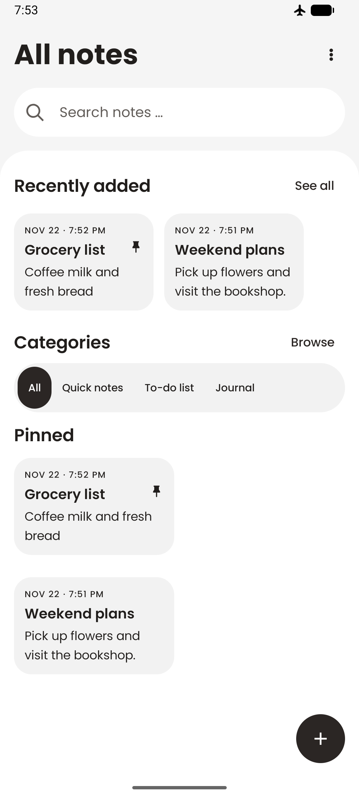
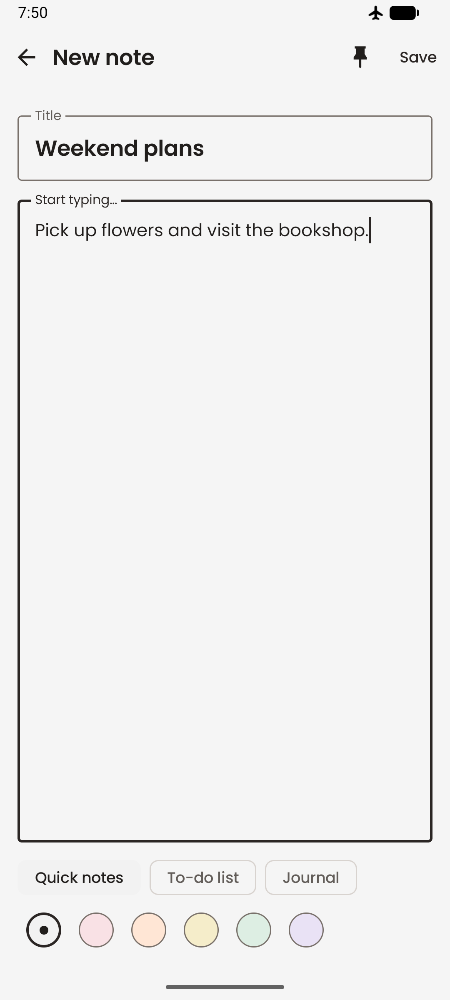
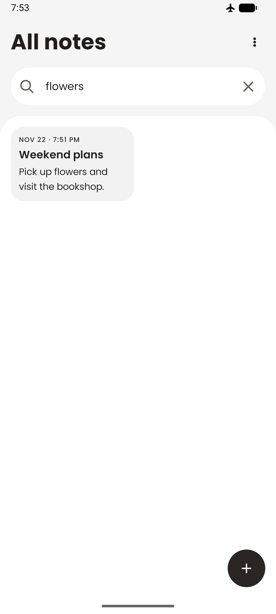
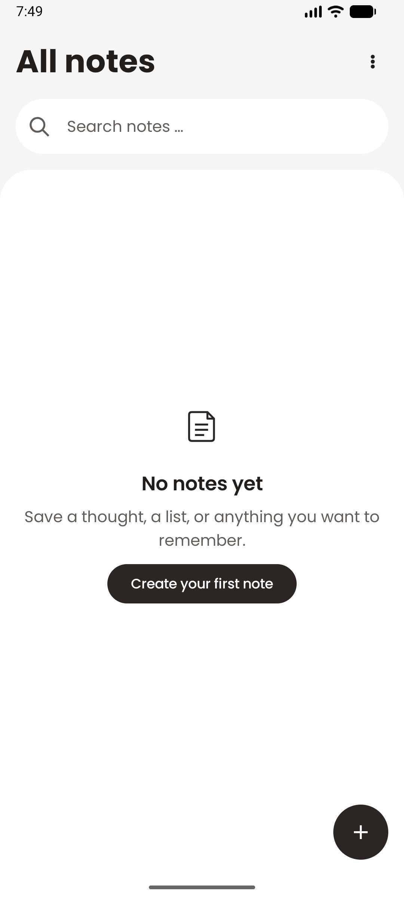
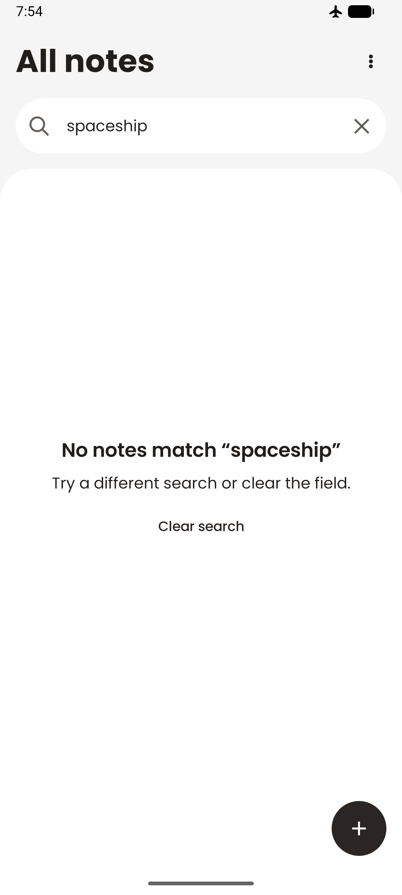
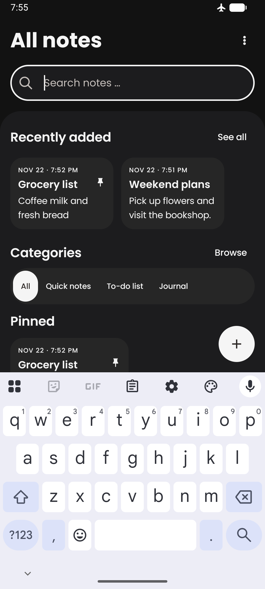
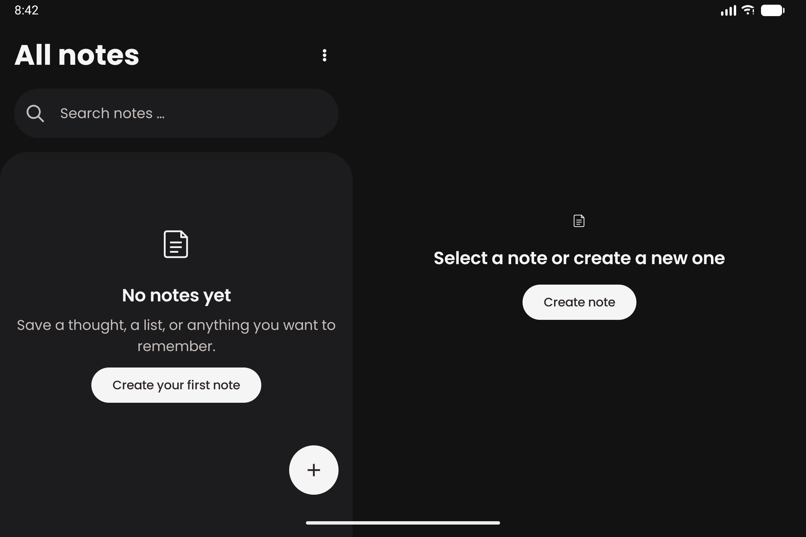
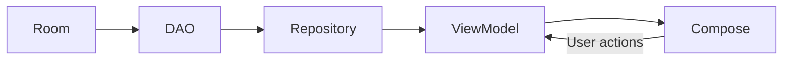

# Cool Notes

Cool Notes is a Kotlin and Jetpack Compose notes app for Android. It runs offline without an account, service, or Internet permission. Notes are stored locally in Room.

## Features

- Create, edit, and delete text notes. Undo a deletion from the snackbar.
- Search titles and bodies as you type. Sort by last updated or title, browse recent notes, or filter by category.
- Pin notes, choose a card color, and organize them as Quick notes, To-do list, or Journal.
- Choose System, Light, or Dark. The app remembers the selection and updates the system bar appearance.
- Keep an unsaved draft through rotation or process recreation. Saving a note and discarding a draft are separate actions.

## Screenshots

| Home | Editor | Search |
| --- | --- | --- |
|  |  |  |

| Empty state | No results | Dark mode |
| --- | --- | --- |
|  |  |  |

## Adaptive layouts

Compact windows show one pane at a time. At 600 dp and above, the list and editor appear side by side, with a highlighted selection and a centered, width-capped editor. A separating vertical hinge can divide the panes. In tabletop posture, the editor places the note above the hinge and actions below it.

Use Ctrl+N to create, Ctrl+S to save, and Ctrl+F to focus search. Right-click a card to open its actions. The list and detail navigation share a workspace, and each editor selection owns its own saved draft.



The landscape image uses a display-size override on the Android 17 phone emulator.

## Build and test

Open the project in Android Studio Rabbit 2 (2026.2.2) or a newer version compatible with AGP 9.5.2. Install Android SDK 37.2 and use JDK 25 for the Gradle daemon. The app runs on API 26 and later. [Android Studio compatibility table](https://developer.android.com/studio/releases#android_gradle_plugin_and_android_studio_compatibility)

```sh
./gradlew assembleDebug
./gradlew testDebugUnitTest
./gradlew connectedDebugAndroidTest
./gradlew lint
```

On Windows, use `gradlew.bat` with the same tasks. Connect an emulator or device for the instrumented tests. Those tests exercise Room queries and migration, note creation and editing, search, delete and undo, and adaptive pane navigation. JVM tests cover note business rules, Flow state, preferences, and window layout decisions.

Install the [debug APK](release/CoolNotes-debug.apk), or regenerate it with `./gradlew :app:stageDebugApk`. Use `./gradlew assembleRelease` to build the optimized release. A distributable release needs an external signing key.

## Architecture



| Technology | Purpose |
| --- | --- |
| Kotlin, coroutines, Flow | Async work and observable screen state |
| Compose, Material 3, Material 3 Adaptive | UI, theming, and list-detail panes |
| Navigation Compose and Kotlin serialization | Type-safe workspace navigation |
| Room and KSP | SQLite persistence, generated DAO code, exported schemas |
| Hilt | Application dependencies and ViewModel creation |
| Preferences DataStore | Theme preference |
| JUnit, Turbine, Room Testing, Compose UI Test | Local and on-device verification |

The repository maps database rows to domain notes, owns transactional writes, and applies save rules. ViewModels combine repository flows with saved UI state. See [design decisions](docs/DESIGN_DECISIONS.md) for trade-offs.

## Schema and migration

The schema snapshots live under [app/schemas](app/schemas). Version 1 stored note IDs, titles, bodies, and timestamps. Version 2 adds pin status, color, and category. Migration 1 → 2 preserves rows and fills new fields with unpinned, default color, and Quick notes. Room tests verify the migration against the exported schemas.

## Implementation notes

- Search uses SQLite substring matching. SQLite's built-in case folding does not cover every Unicode case pair.
- The platform's starting splash follows the device theme on Android 8–11. The first app frame uses the saved theme.
- The app has no cloud-sync transport. Android system backup is enabled by the manifest and is governed by the device's backup settings.
- The configured phone emulator can exercise compact and wide layout widths. Physical fold postures, freeform resizing, and multiple desktop windows require separate device verification.

Future improvements include FTS4 search, pagination, explicit export and import, tags, and more tablet workflow refinements.
